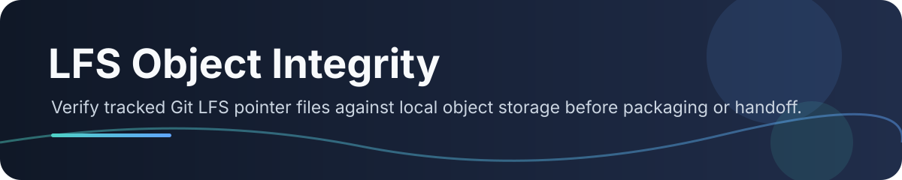

<p align="center"></p>

# LFS Object Integrity ✨

> Verify tracked Git LFS pointer files against local object storage before packaging or handoff.

[](https://github.com/MofidChallenge10/lfs-object-integrity/actions/workflows/ci.yml) [](LICENSE) 

## 🎯 Why this project?

Verify tracked Git LFS pointer files against local object storage before packaging or handoff. It focuses on a narrow operational problem and keeps its output inspectable, deterministic, and suitable for scripts or CI.

## 🚀 Features

- 🧭 Solves the documented use case without a hosted service.
- 🧪 Includes repeatable tests and a runnable example.
- 📄 Supports concise human-readable output; machine-readable output is available where documented.
- 🔒 Avoids changing the target system during inspection.

## ⚡ Quick Start

```bash
php bin/lfs-object-integrity.php --root .
```

## 🖥️ Example

```text
Tracked LFS pointers: 3
Verified objects: 2
Missing objects: 1
Mismatched sizes: 0
```

## 🗺️ Roadmap

- Add an optional remote verification mode using `git lfs fsck` when installed.
- Add a machine-readable SARIF output for CI.
- Add a dry-run report of objects that would need fetching.

## 🤝 Contributing

See [CONTRIBUTING.md](CONTRIBUTING.md). Bug reports should include the command, a minimal input fixture, and the observed output. Please do not attach credentials or private production data.

## 📜 License

MIT — see [LICENSE](LICENSE).
